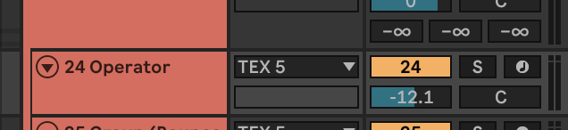
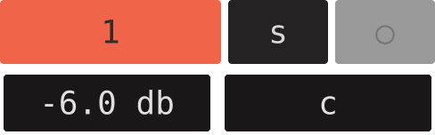

# source-rendered comparison for PR439

The original supplied reference bytes remain unchanged:

Measured header-control subset of the completed GPUI scene, plotted at four-times scale:

This second image is a diagnostic **scene reconstruction**, not a GPU framebuffer,
native screenshot or installed acceptance. Bounds and background colors are read
from the production render through the existing GPUI test API. Captions use the
actual fixture's canonical gain0.5 (-6.0db), balance0 (c), and track number1;
their centered plotting is not evidence of native font glyph shaping or final
contrast. The bundled font is included with its OFL license for artifact viewing.
Linux uses no-op text shaping. The same reference-layout test selects native
bundled Ioskeley shaping on macOS; Root owns that check and physical comparison.

The original actual UI test failed with a86×21 volume root and a separate46×18
value at a19px horizontal center offset. Its unedited raw failure is retained in
baseline-rendered-layout.txt and the full baseline run. The new actual scene has
one60×18 root,58×16 combined well/readout with the existing one-pixel focus inset,
and centered value. Normal minimum headers remain176×44. The122×38 two-row cluster
uses62px activator,28px Solo/disabled-arm cells, and60px volume/pan fields.
Reference controls are approximately92×27 and42px buttons; the cluster keeps that
compact composition using Hex's existing palette, original scalar ranges and font.

The arm circle is disabled/unavailable (Pulse26 /0.2), and Return pan/Solo are
omitted because no such canonical fields exist. This does not complete those
functional requirements or claim Live numerical/physical parity. Native checklist
is in docs/track-header-volume.md. Full integration/review remains merger-owned.
